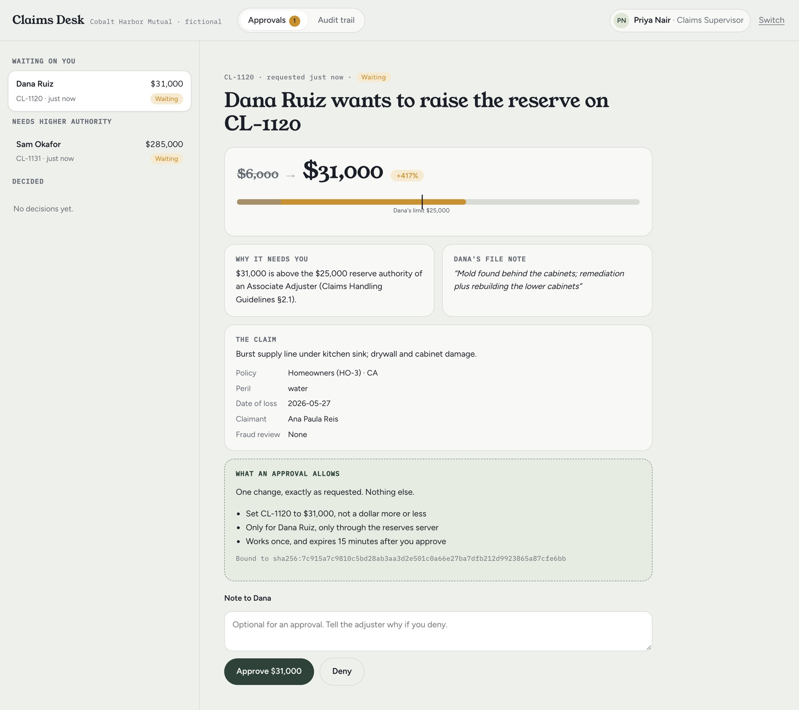
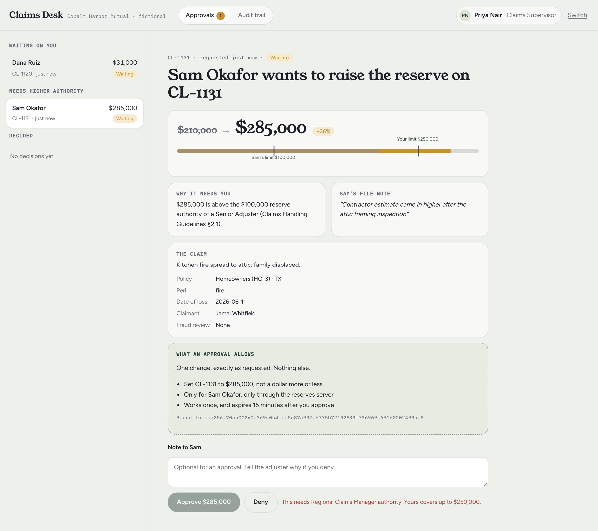

# Claims Desk MCP

An MCP server that lets an AI assistant work insurance claims, but not past the
adjuster's authority. Any reserve above that limit needs a supervisor's approval,
and the approval is tied to that exact change.

It's built for the same fictional insurer as
[Coverage Copilot](https://github.com/slimebizzy/coverage-copilot), Cobalt Harbor
Mutual. The authority limits come straight from that insurer's own claims guidelines:

| Who | Can set a reserve up to | Source |
|---|---|---|
| Associate Adjuster | $25,000 ($50,000 on hail or wind during a declared catastrophe, unless the claim is under fraud review) | §2.1, §2.3 |
| Senior Adjuster | $100,000 | §2.1 |
| Claims Supervisor | $250,000 | §2.1 |
| Regional Claims Manager | any amount | §2.1 |



## What happens when an assistant goes over the limit

This is a real run with Claude as the MCP client, acting for an Associate Adjuster
([full transcript](evidence/agent-transcript.txt)):

```
Dana: The roof inspection on CL-1042 came back ... Raise the reserve to $62,000.

  -> claim.get {"claim_id": "CL-1042"}
  -> claim.set_reserve {"claim_id": "CL-1042", "amount": 62000, "reason": "Roof inspection completed: ...", ...}
  <- error {"status": "approval_required", "request_id": "req_4197fa9ddf15", "required_role": "Claims Supervisor", ...}

Claude: The reserve on CL-1042 is still $18,000. Raising it to $62,000 needs a Claims Supervisor to approve it.
        $62,000 is over your $50,000 limit as an Associate Adjuster on catastrophe claims (§2.3). ...

      [Priya Nair approves it in the console]

  -> approval.status {"request_id": "req_4197fa9ddf15"}
  -> claim.set_reserve {... same arguments ...}  [approval apr_cc6e56666a77875d]
  <- {"status": "updated", "previous_reserve": 18000, "reserve": 62000, ...}
```

Claude gave a file note without being asked, because the tool description says a
change over 50% needs one. It didn't try to get around the limit, and it applied
exactly the approved amount.

## An approval is a record, not a permission

Once Priya approves the change, the server issues a signed approval record bound to:

- **Who:** the adjuster who asked for it.
- **What:** the tool and a digest of the exact arguments.
- **Where:** the server it was approved for.
- **When:** a 15-minute expiry.
- **How often:** it works once.

| Try to | Result |
|---|---|
| Apply $62,001 with a $62,000 approval | `Arguments differ from what was approved` |
| Use the approval a second time | `Approval was already used` |
| Use someone else's approval | `Approval was granted to a different user` |
| Use it after 15 minutes | `Approval expired` |
| Edit the stored record | `Approval signature is invalid` |
| Approve your own request | refused |
| Approve above your own authority | refused; it goes to the queue of someone with enough authority |



## The approval console

The supervisor's side of the story, and the design half of the project.

- **The decision on one screen.** The old and new reserve, a scale showing the
  adjuster's limit and yours, why the change needs you (with the guideline section),
  and the adjuster's file note.
- **Approvals that state their limits.** A dashed box spells out exactly what the
  approval allows, including the digest it's bound to.
- **Routing by authority.** Requests above your authority sit under "Needs higher
  authority", with Approve disabled and the reason given, not a silent failure.
- **Polling that doesn't lose your work.** The queue refreshes every few seconds,
  but the open request only redraws when it actually changes. A half-typed note
  survives. (The first version wiped it; I caught that while testing.)
- **Audit trail.** Every call: who, which replica, the decision, why, the arguments
  with sensitive fields redacted, latency, and the trace id.

## The protocol work

This follows the stateless MCP revision `2026-07-28` and the course's
[Capstone 13](https://github.com/rohitg00/ai-engineering-from-scratch/tree/main/phases/19-capstone-projects/13-mcp-server-with-registry):

- **No sessions.** There's no `initialize` handshake. Every request carries its
  protocol version and client capabilities in `params._meta`, so any replica can
  answer any request.
- **Error codes:**
  - A missing or non-string version is `-32602`.
  - An unsupported version is `-32022`, with exactly `{supported, requested}`.
  - A request whose `MCP-Protocol-Version`, `Mcp-Method` or `Mcp-Name` header
    disagrees with its body is `-32020`, rejected before authorization or any tool runs.
- **Two surfaces, two audiences.** `/mcp/read` (claim lookup, policy search) and
  `/mcp/claims` (reserves) each accept only tokens minted for them. A read token
  presented to the reserves server fails audience validation.
- **Every call is checked:** issuer, audience, expiry and scope, then a policy
  decision on the concrete arguments: assignment, authority, the 50% file-note
  rule, and the approval.
- **`tools/list` is cache-friendly:** stable order, `ttlMs`, and `cacheScope: private`,
  because what you see depends on your scopes.
- **Retries are safe.** `idempotency_key` makes a retried write return the first
  result instead of applying twice.
- **Registry records live in [`registry/`](registry/).** A check validates them,
  verifies the publisher namespace, probes the live `server/discover`, and reports drift.

## Evidence

| Check | Result | File |
|---|---|---|
| Unit and contract tests | 40 pass | `tests/` |
| Wire cases, each sent directly to a replica and again through the load balancer | 14 of 14 pass; identical status and identical bytes both ways; no tokens in the capture | [`evidence/wire.jsonl`](evidence/wire.jsonl) |
| 200 concurrent requests through a round-robin balancer, no affinity | 100 per replica; 60 concurrent writes to one claim from both replicas, none lost; 20 keys sent twice at once, each applied once | [`evidence/load-test.json`](evidence/load-test.json) |
| Registry admission | both records admitted; pointing a record at the wrong endpoint is caught as drift | [`evidence/registry-report.json`](evidence/registry-report.json) |
| Claude as the client | stopped at the limit, applied exactly the approved amount | [`evidence/agent-transcript.txt`](evidence/agent-transcript.txt) |

## Run it

```bash
python3 -m venv .venv && .venv/bin/pip install -r requirements.txt
make test          # 40 tests, no network
make cluster       # two replicas behind a balancer on :8800, fresh data
make evidence      # wire, load and registry checks against the running cluster
open http://127.0.0.1:8800/console
make agent         # Claude as the adjuster's client; needs ANTHROPIC_API_KEY in .env (about $0.10)
```

## What this doesn't do yet

These are honest gaps, and the next things I'd build:

- **Tokens:** they come from a local stand-in for the authorization server (HS256
  with a shared secret). Production would validate RS256 tokens against the issuer's
  JWKS and use the real OAuth flow with resource indicators.
- **Shared state:** it's one SQLite file in WAL mode, which works because both
  replicas run on one machine. Across machines it would be Postgres.
- **Streaming:** responses are single JSON objects. Request-scoped SSE streams,
  cancellation races and timeouts aren't exercised.
- **Registry:** the validator is a partial check of the remote profile. Real
  publication would go through the official schema and `mcp-publisher`.
- **Rollback:** there's no admission ledger or rollback evidence.

---

All people, claims and policies are fictional.
